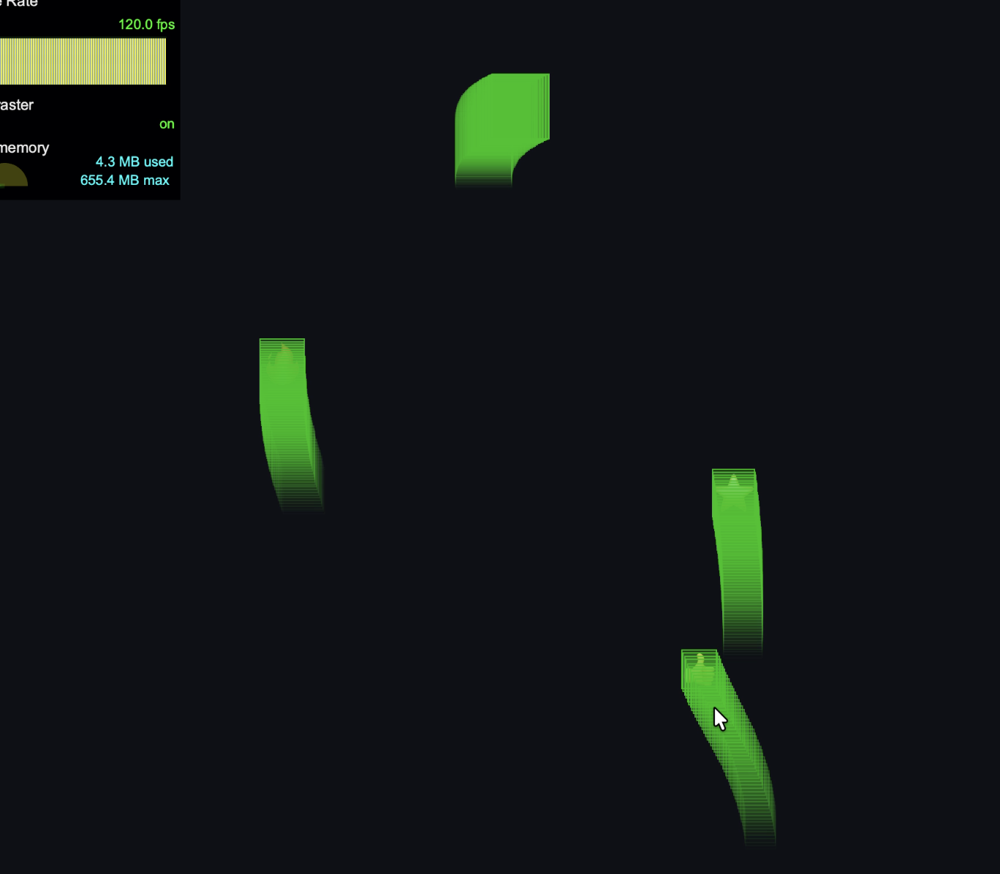
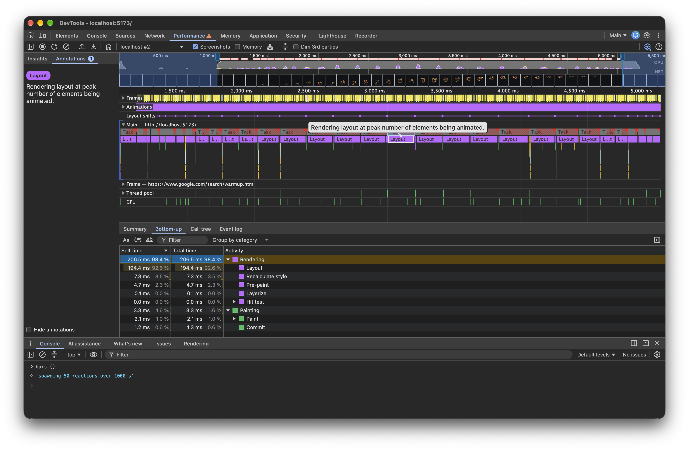
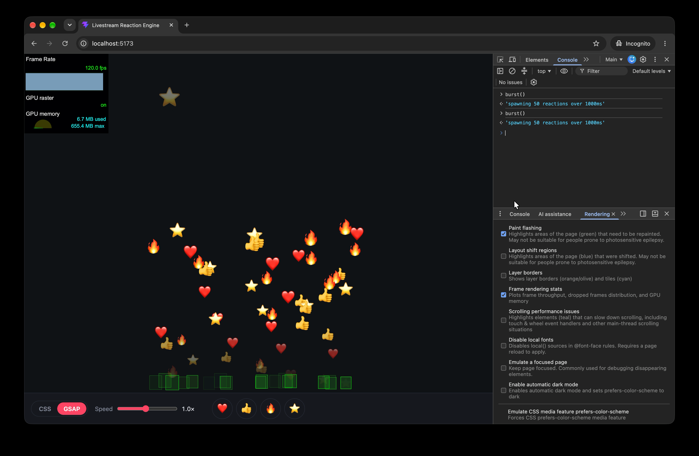
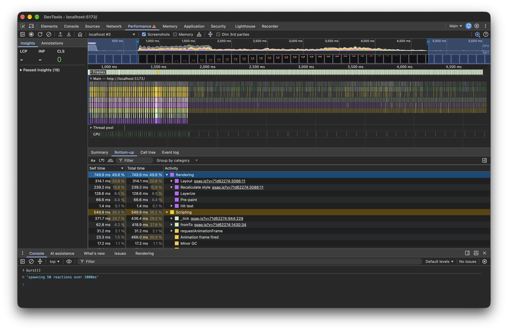

# Livestream Reaction Engine — Submission

> Architecture decisions made while building this project are logged in [DECISIONS.md](./DECISIONS.md).

## 1. Setup & Running Instructions

Requirements: Node.js ^20.19 or >=22.12 (required by Vite 8) and npm, plus Google Chrome for profiling.

```bash
npm install
npm run dev
```

Open the local URL Vite prints (usually http://localhost:5173) in Chrome.

**Controls** (in the bar at the bottom of the page):
- **CSS / GSAP toggle** (left): picks which engine new reactions use. CSS is Phase 1 (`@keyframes` animating layout properties); GSAP is Phase 2 (transforms and opacity only).
- **Speed slider (0.1×–2.0×)** (next to the toggle, GSAP mode only): changes the speed of every GSAP reaction in flight, in real time.
- **Emoji buttons** (centre): send a reaction.

**Profiling helpers** (dev server only; type these into the DevTools console):

| Command | What it does |
|---|---|
| `burst()` | Spawns 50 random reactions spread over 1 second |
| `burst(100, 500)` | Spawns 100 reactions over 0.5 seconds |
| `reactionCount()` | Reactions currently in the DOM. Returns `0` once all have finished (no zombie nodes) |

## 2. Phase 1: CSS Keyframes Analysis

* **Paint Flashing Screenshot:**
  
  Recording: [phase1-paint_flashing.mov](docs/screenshots/phase1-paint_flashing.mov)
* **Performance Profile Screenshot:**
  
  Trace: [phase1 flame chart trace](docs/screenshots/phase1_flamechart_trace) (load in DevTools → Performance)
* **Observations:**
  * The animations are smooth when triggered one at a time. With 50 floating reactions on screen at once, the frame rate drops noticeably, and with CPU throttling it drops horribly. Flame chart blocks are longest in the middle of the burst, where early flights are still ongoing and the last ones are just starting. Layout cost grows with the number of animations on screen.

  **2.1** What regions of the screen flashed green during high-concurrency spawning, and why?

  * Floating emojis and the paths they travelled flashed green. Each reaction had a green box over its current position, with a trail of empty green boxes below it over spots it had already left. These are paint invalidation regions: when an element moves, the browser repaints both its new rectangle and the old one, so the old spot can be filled back in with the background. This happens because the keyframes animate `bottom`, `left` and `font-size`. These are layout properties, so the browser recalculates layout and repaints every frame instead of just moving an already-painted layer. The FPS meter still read 120 fps, but its frame bars were yellow and orange (partially presented frames), and I could clearly see frames dropping.

  **2.2** What did the main thread activity (Layout, Recalculate Style, Paint) look like in the flame chart?

  * Tasks got longer toward the middle of the burst. At the busiest point the main thread was saturated and the overview showed red, meaning long tasks (>50ms). Layout clearly took the longest. In the annotated slice at peak load, Layout was 194.4 ms (92.6%), Recalculate Style only 7.3 ms and Paint 2.1 ms. Every frame, the browser re-lays out each reaction whose `bottom`, `left` or `font-size` changed, so layout cost grows with the number of reactions in flight. Animating `font-size` makes it worse, because each emoji's text has to be measured again at its new size.

## 3. Phase 2: GSAP & Composited Rendering Analysis

* **Paint Flashing Screenshot:**
  
  Recording: [phase2-paint_flashing.mov](docs/screenshots/phase2-paint_flashing.mov)
* **Performance Profile Screenshot:**
  
  Trace: [phase2 flame chart trace](docs/screenshots/phase2_flamechart_trace.json) (load in DevTools → Performance)
* **Observations:**

  **3.1** How did the flame chart and frame rate change compared to Phase 1?

  * The animations stay smooth with 50 reactions on screen, even with the same CPU throttling as Phase 1. Unlike Phase 1, the heavy work only happens while reactions are being spawned, then the main thread settles into a thin, regular pattern even though all 50 are still flying. There were no red long tasks, and the Frames lane was almost all green. Each new reaction has to be styled and laid out once when it's added to the DOM, but after that moving it costs almost nothing on the main thread.

    Bottom-up shows Rendering at the top (749.9 ms), then Scripting (549.9 ms). Most of the Layout (314.1 ms) and Recalculate Style (239.2 ms) happened in the first second, while reactions were being inserted into the DOM. Once spawning ended they almost disappeared, even though GSAP writes `transform` and `opacity` inline every tick. The rest of Rendering was Layerize (128.6 ms) and Pre-paint (66.6 ms): the browser preparing composited layers, not repainting pixels. The trade-off is Scripting: GSAP runs a JS tick every frame (`_tick`, 436.4 ms total), which Phase 1's CSS keyframes didn't need. Compared by share rather than raw time (the Phase 1 screenshot covers a single slice at peak load), Layout went from 92.6% of main-thread time in Phase 1 to 20.8% in Phase 2, and that 20.8% is almost all at spawn time.

  **3.2** What happened to the green paint invalidation areas once animations moved to composited transforms (`x`, `y`)?

  * The green trails disappeared. Each emoji flashed green once when it was spawned, and then nothing flashed while it floated up. This is because GSAP only animates `x`, `y`, `scale` and `opacity`, which become CSS `transform` and `opacity`. The browser paints each emoji once into its own layer, and the compositor just moves, scales and fades that layer on the GPU. Rendering the emoji at its largest `font-size` and scaling up to `1` keeps the layer from going blurry.

## 4. Architectural Reflection

**4.1 Runtime Control & Developer Experience:** How does adjusting playback speed or randomizing flight paths mid-flight compare between static CSS rules and programmatic timelines?

* Adjusting the playback speed in GSAP takes one line because every reaction's timeline is a child of a master timeline. The master timeline keeps the reactions' current position so all reactions can speed up or slow down smoothly. We can try to use animation-duration for reactions but the animations will jump when adjusting the playback speed because the browser keeps elapsed time and calculates progress against the new duration.

* Both engines randomize `createFlightParams()` at spawn. However, because CSS writes the keyframes in terms of `var()`, the values are decided once, which is at spawn. Changing path mid-flight makes the reaction jump, too. With GSAP you can `kill()` one tween and start a new one from the reaction's current `x` forming a new motion from the current state.
* With CSS, the developer experience is a little messy and decentralized, being split across two files: motion in `css-engine.css`, and per-reaction values plus DOM events/lifecycle in `cssEngine.js`. Cleanup depends on `animationend` and there is also a setTimeout fallback in case the event never fires. For GSAP, one timeline keeps the motion, values, and an onComplete that removes the node. As mentioned in the first paragraph we can retime it for this reason. 

**4.2 Pipeline Considerations:** If our application needed to dynamically tint, re-theme, or alter these reaction assets at runtime based on active user preferences, what architectural considerations dictate choosing programmatic vector manipulation over pre-rendered raster image sequences?

* First off, raster doesn't scale well. Our reactions grow mid-flight and need to look sharp on high-DPI screens, so we'd need @1x/@2x/@3x exports, while a vector just redraws at any size. The colour is also baked into every frame, so you end up with reactions x themes x light/dark x resolutions, and with a colour picker it's basically impossible. Pipeline-wise, every new theme means a designer re-exporting everything, but with vectors it's one asset per reaction and a new theme is just a config change. Vectors are also way more flexible: with SVG you can tint just the heart's fill or animate the colour right in the GSAP timeline, while with raster you're stuck with `hue-rotate()`, which shifts every colour. Changing theme mid-flight is easy too, since we just update the colour instead of downloading new frames. Complex vectors can be slower to render, but our icons are small and simple, so that's not really a concern.
