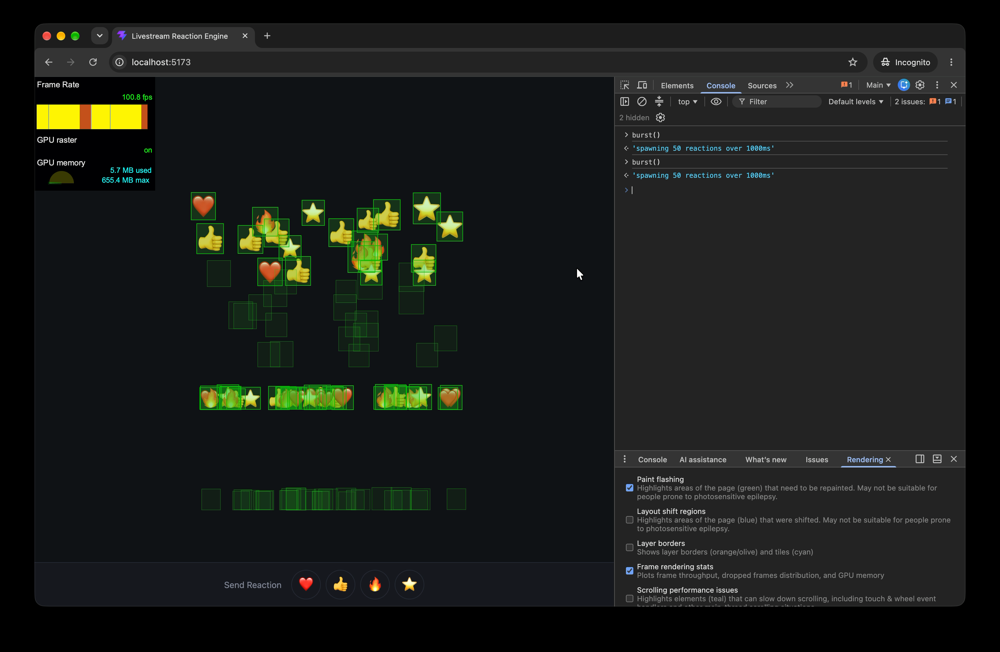
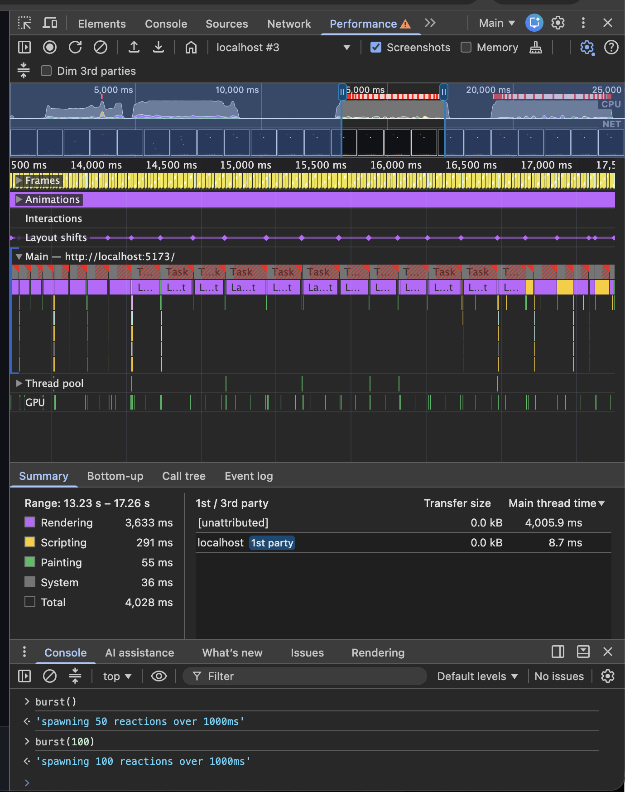

# Livestream Reaction Engine — Submission

> Architecture decisions made while building this project are logged in [DECISIONS.md](./DECISIONS.md).

## 1. Setup & Running Instructions

Requirements: Node.js and npm, plus Google Chrome for profiling.

```bash
npm install
npm run dev
```

Open the local URL Vite prints (usually http://localhost:5173) in Chrome.

**Profiling helpers** (dev server only; type these into the DevTools console):

| Command | What it does |
|---|---|
| `burst()` | Spawns 50 random reactions spread over 1 second |
| `burst(100, 500)` | Spawns 100 reactions over 0.5 seconds |
| `reactionCount()` | Reactions currently in the DOM. Returns `0` once all have finished (no zombie nodes) |

## 2. Phase 1: CSS Keyframes Analysis

* **Paint Flashing Screenshot:**
  
  Recording: [phase1-paint-flashing.mov](docs/screenshots/phase1-paint-flashing.mov)
* **Performance Profile Screenshot:**
  
  Recording: [phase1-performance.mov](docs/screenshots/phase1-performance.mov)
* **Observations:**
  * General: the animations are smooth when triggered one at a time. With 50 floating reactions on screen at once, the frame rate drops noticeably. With CPU throttling added, frame rate drops horribly.
  * What regions of the screen flashed green during high-concurrency spawning, and why?
    Only the floating emojis flashed green. Each reaction had its own green box on every frame, while the stage background and the control bar never flashed. This happens because the keyframes animate `bottom`, `left` and `font-size` and are layout properties. The browser recalculates layout and repaints the element every frame. The repaints stayed limited to the emojis because Chrome only repaints the areas that changed, and because the reactions are `position: absolute`, so their movement never pushes other elements out of place. Near the spawn area the green boxes overlapped where reactions were clustered, so those areas were repainted more than once per frame. The FPS meter showed about 100 fps, but its frame bars were yellow and orange (partially presented and dropped frames). The browser was struggling to keep up. The cost isn't the size of the repainted area. It's that all 50 elements are laid out and repainted again on every frame. Faint, empty green boxes also trailed beneath each emoji. Those mark the positions the reactions had just left. When an element's geometry changes, Chrome repaints both its new area and the area it vacated (to redraw the background there), so each moving reaction causes at least two repaints per frame.
  * What did the main thread activity (Layout, Recalculate Style, Paint) look like in the flame chart?
    In the busiest part of the 50-reaction burst (a ~4s window with 6x CPU throttling), the main thread was saturated. Rendering took 3,633 ms (~90%), while Scripting took 291 ms (~7%). Nearly all of that Scripting came from spawning reactions at the start and end of the burst, so during flight almost every Task was just a single large Layout block. Each Task was flagged as a long task (>50 ms) and took roughly 120–170 ms, so the frame rate fell from a smooth 120fps (8.3 ms frames) to roughly 6–8fps. The Frames track was solid yellow (partially presented or dropped frames). The tasks got longer as more reactions joined the flight. Every frame, Chrome has to re-lay out each reaction whose `bottom`, `left` or `font-size` changed, so Layout cost grows with the number of reactions in flight. Animating `font-size` makes it worse, because each emoji's text must be measured again at its new size.

## 3. Phase 2: GSAP & Composited Rendering Analysis

* **Performance Profile Screenshot:** _TODO_
* **Observations:**
  * How did the flame chart and frame rate change compared to Phase 1?
    _TODO_
  * What happened to the green paint invalidation areas once animations moved to composited transforms (`x`, `y`)?
    _TODO_

## 4. Architectural Reflection

* **Runtime Control & Developer Experience:** How does adjusting playback speed or randomizing flight paths mid-flight compare between static CSS rules and programmatic timelines?
  _TODO_
* **Pipeline Considerations:** If our application needed to dynamically tint, re-theme, or alter these reaction assets at runtime based on active user preferences, what architectural considerations dictate choosing programmatic vector manipulation over pre-rendered raster image sequences?
  _TODO_
